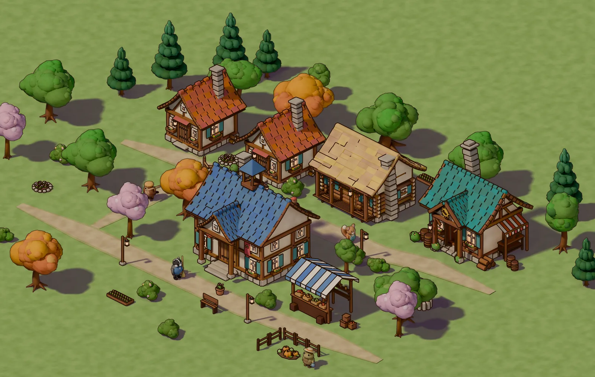
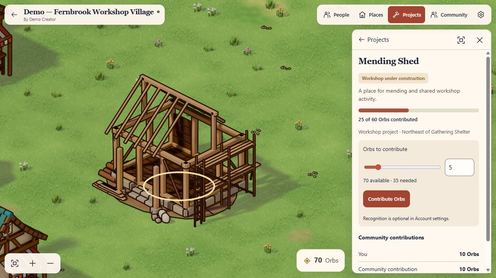
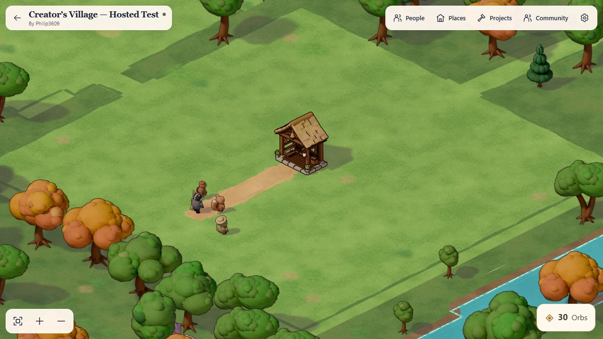
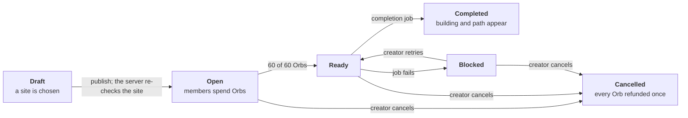
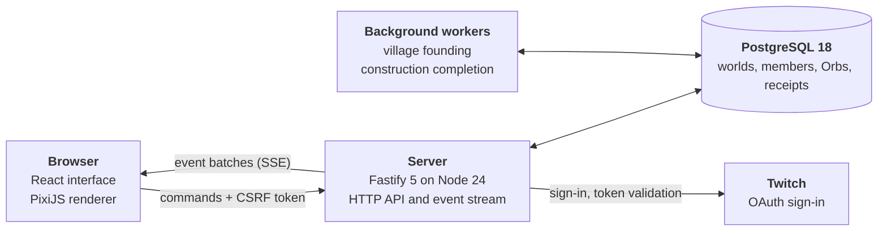

<div align="center">

<picture>
  <source media="(prefers-color-scheme: dark)" srcset="docs/readme/hearth-ring-dark.svg">
  
</picture>

# Creator's Village

**A persistent village that a creator and their community build together.**

Sign in with Twitch, walk into a hand-lit isometric village, pool a shared currency, and watch a building go up on the real map. Everyone who is allowed in sees the same world, and it is still there tomorrow.

[](https://github.com/Philipjj609/creators-village/tree/hackathon-2026-11-02-r1)
[](#testing-and-reproducibility)
[](#getting-started)
[](#credits-provenance-and-licensing)

[**Live application**](https://creators-village.onrender.com/) ·
[**Explore the public example**](https://creators-village.onrender.com/villages/showcase-fern) ·
[Judging guide](JUDGING.md) ·
[Release notes](RELEASE.md) ·
[R1 tag](https://github.com/Philipjj609/creators-village/tree/hackathon-2026-11-02-r1)

</div>

<!-- Demo video and Devpost project links: add them to the line above once their final URLs are public. -->



<sup>The landing illustration, rendered with the project's own art pipeline. It is a promotional image, not a gameplay screenshot; real screenshots are [below](#what-it-looks-like).</sup>

Creator's Village is a community game for people who gather around a Twitch creator. A creator owns one persistent village. Approved members can fund and build things in it together, using a village currency called **Orbs** that is separate from Twitch Channel Points and Bits. The village is generated from a seed, stored in PostgreSQL, and every change goes through the server, so what you see is what everyone else sees.

It was built for the TwitchCon Codex hackathon (deadline 2 November 2026) and is meant to keep growing after it. The code on `main` is the submitted **R1** snapshot. Work on follower discovery is happening on a [separate branch](#status-at-a-glance) and is not part of the submitted release.

I, Philip Ciuca, develop it as an individual developer, with extensive AI assistance: OpenAI Codex wrote most of the application code, Claude Code built the art pipeline and the follower-discovery branch, and ChatGPT produced concept images. I set the direction, accept or reject the work, and make the product and release decisions. [Credits and provenance](#credits-provenance-and-licensing) lists what came from where.

---

## Contents

[Status at a glance](#status-at-a-glance) · [The idea](#the-idea) · [What you can do today](#what-you-can-do-today) · [What it looks like](#what-it-looks-like) · [What is implemented in R1](#what-is-implemented-in-r1) · [How it works](#how-it-works) · [Technology](#technology) · [Getting started](#getting-started) · [Configuration](#configuration) · [Testing and reproducibility](#testing-and-reproducibility) · [Security and privacy](#security-and-privacy) · [Known limitations](#known-limitations) · [Roadmap](#roadmap) · [Hackathon](#hackathon) · [Credits, provenance and licensing](#credits-provenance-and-licensing) · [Documentation](#documentation)

---

## Status at a glance

Three stages are kept apart on purpose. Only the first one is shipped.

| Stage | What it covers | State |
|---|---|---|
| **R1: submitted release** | Twitch sign-in, persistent creator village, generated terrain, four fictional residents, Orb wallets, pooled funding and construction of a workshop, server-checked placement and road connection, live synchronisation | **Implemented, tested, deployed** as a private playtest. This is `main` and tag `hackathon-2026-11-02-r1`. |
| **F4: follower discovery** | Optional discovery of villages whose creators you follow, creator-controlled joining without individual approval, a member limit independent of the simulation, delegated permissions | **Implemented on the [`post-submission/follower-discovery`](https://github.com/Philipjj609/creators-village/tree/post-submission/follower-discovery) branch. Not merged, not deployed, not yet verified with real Twitch accounts.** Its migration (010) has not been applied to any hosted database. |
| **Vision** | Personal homes and personalised residents, more buildings, land clearing, districts, regional communities, shared events | **Ideas only.** None of it exists in the code. |

## The idea

Twitch communities have a lot of shared attention and nowhere to keep it. A stream ends, the chat scrolls away, and little is left. Creator's Village asks what a community would build if it had a place that stayed: somewhere to return to, that shows what people did together and that the creator can open to the people they trust.

The design follows from a few commitments:

- **A real place, not a dashboard.** The village is a map with terrain, paths, buildings and residents, not a list of counters.
- **Contributions are visible and deliberate.** Orbs are spent on a specific project, and the building that results appears on the shared map.
- **The creator stays in charge.** Following a channel never grants access by itself, and Twitch roles are never treated as village permissions.
- **Honest about what exists.** No invented members, activity or counters. Fictional residents are labelled as fictional.

## What you can do today

The hosted application is a **private playtest**: village creation and membership are closed to the public, and signing in does not create a village or send a join request. What anyone can do:

1. **Explore the public example.** [`/villages/showcase-fern`](https://creators-village.onrender.com/villages/showcase-fern) is a read-only, deterministic village with no member activity. Pan, zoom, select buildings and residents, follow a resident with the camera.
2. **Sign in with Twitch** (as an authorised creator or member). Sign-in asks for no extra permissions. **My Communities** then lists your own village and any villages you have been admitted to.
3. **Enter a village and look around.** The *People*, *Places* and *Projects* panels list inhabitants, buildings and construction as keyboard-accessible lists as well as on the map.
4. **Earn and spend Orbs.** Your wallet is topped up while you are active in the village. Fund a project from its panel with a slider or a number.
5. **Plan a workshop (creator).** Choose a site; the server tells you whether it is valid and shows the path that will connect it. Publish it and the community can fund it.
6. **Watch it complete.** When the goal is met, the building and its connecting path appear for everyone connected, and a resident gains a workplace there.

The first request after a quiet period can take up to a minute: the prototype runs on free hosting that sleeps.

## What it looks like

| | |
|:--|:--|
|  |  |
| **Funding a workshop.** The isolated demonstration used for review, with synthetic *demo* accounts. The contributions shown are test data, not community activity. | **The hosted R1 village.** A creator's own village after Orb activation: the founding shelter, fictional inhabitants on the path, and the starting balance of 30 Orbs. |

<sup>Both are 1280×720 captures of the running interface. Artwork is original; see [provenance](#credits-provenance-and-licensing).</sup>

## What is implemented in R1

Everything in this section exists in the code on `main` and is covered by the test suite unless a limitation says otherwise.

### A persistent village

- **Generated, saved terrain.** A village starts from a seed. The generator produces a bounded 512 × 512 cell landform (a creek bend, a lake edge or a wooded ridge) in 256 chunks, which are then stored in PostgreSQL and hash-verified. A saved world is always read by the reader for its own version and is never regenerated by a newer generator.
- **A founding settlement.** Every village begins with a gathering shelter and a path. Nothing else is invented: no homes, no accomplishments.
- **Survives restarts.** Reloading, reconnecting or restarting the server returns the same village; tests assert this against fresh application instances.
- **Isometric rendering.** React drives the interface and PixiJS draws the world: per-chunk terrain with level of detail, depth-sorted sprites, camera follow, and reduced-motion handling.

### Autonomous residents

Four **fictional woodland inhabitants** live in each village. They are not Twitch participants, and the interface labels them "Fictional inhabitant".

- Their routines are a **pure function of the world, the topology and UTC time**: they walk to reachable destinations, work, gather, rest and idle. No server loop runs per village, and a long absence costs the same as a short one.
- Routes follow the same terrain rules as construction, including protected cells. When a workshop is completed, a resident gains a workplace there.
- Selecting a resident, following them, and the *People* list work with the keyboard as well as the pointer.

### Orbs, pooled funding and construction

Orbs are the village currency. They are **not** Twitch Channel Points or Bits, and nothing is bought with money.

| Rule | Value |
|---|---|
| Starting balance | 30 Orbs, granted once, on a member's first eligible visit |
| Earning | 5 Orbs per completed five-minute active interval, capped at 120 |
| Cost of the supported workshop | 60 Orbs, pooled from any number of members |

Balances, deductions, receipts and completion are decided on the server. The browser never sends a balance, a price or a completion.



- **Server-authoritative placement.** A site is checked against terrain slope, water, trees, rocks, existing buildings, protected cells and the active boundary. The preview you see is advisory; creation and publication run the check again.
- **Road connection.** A new workshop is connected to the existing path network, and the connection is validated and stored as part of the project.
- **Exactly-once funding.** Each spend carries a command ID. Repeating a request returns the original receipt, and concurrent spends are serialised so a project cannot be over-funded.
- **Cancellation refunds.** Cancelling returns every contributed Orb once, and the history is kept.
- **Optional, withdrawable recognition.** Contributions are private by default. A member can opt in to being named on a project, and withdraw that later.
- **Legacy projects keep their rules.** Projects created before the Orb economy keep their original action-based rules and receipts.

### Twitch sign-in and where the integration stops

| Used in R1 | Not in R1 |
|---|---|
| Twitch OAuth authorization-code flow, with the client secret held on the server | Reading who you follow, or follower lists |
| **No scopes requested**: only your Twitch identity | Subscriptions, Bits, Channel Points |
| Token validation at login and hourly, encrypted token storage, revocation ends the session | EventSub, chat commands or a chat bot |
| Identity is used to find your existing village and memberships | A Twitch Extension or OBS overlay |

A Twitch follow, moderator badge or channel role never grants access. Access comes only from the creator's own membership and grant records.

### Live, authenticated synchronisation

Everyone in a village receives the same committed changes: funding progress, completions, membership changes. Updates stream over server-sent events with a cursor; on a gap, the client replays missed batches or reloads current state. When the connection drops, the interface says so and recovers without losing committed work. Access changes reach open streams, which are then closed.

### Membership and moderation

Creators issue one-use invitation links (24-hour expiry). A link grants nothing by itself: the person signs in, confirms the account, and the creator approves the request. Creators can decline, ban, unban and manage members; leaving revokes access and consents.

## How it works



The monorepo has two apps and four packages:

| Path | Role |
|---|---|
| `apps/web` | React interface and the Pixi scene host |
| `apps/server` | Fastify API, Twitch adapter, sessions, commands, event stream, background workers |
| `packages/contracts` | TypeBox schemas and shared types for every request, response and event |
| `packages/domain` | Pure shared rules |
| `packages/world` | Deterministic terrain, spatial rules and the resident-routine engine |
| `packages/renderer` | The PixiJS village renderer |
| `db/migrations` | Ordered SQL migrations 001 to 009 |
| `tests`, `scripts`, `deploy` | Vitest suites, build and release tooling, runtime grants |

### Engineering decisions worth knowing

- **The server decides; the client proposes.** Clients send intents (a site, an amount, a command ID). Amounts, prices, eligibility and results are computed in PostgreSQL transactions. Optimistic completion is never shown.
- **Deterministic generation, versioned readers.** Terrain, residents and examples are pure functions of seed, version and time. Saved worlds record their format version, and the matching reader loads them.
- **Idempotent commands with receipts.** Each mutating command has a client-chosen ID and a stored receipt; the same request returns the same result and a changed request with the same ID is refused.
- **Locks where order matters.** Joins, funding, completion and topology changes take row or advisory locks in a fixed order. Anything that could change connectivity serialises behind a topology guard.
- **Additive migrations and a strict schema fence.** Migrations never rewrite history. The server verifies the exact applied migration set (with checksums) at startup and **never migrates automatically in production**; a separate, bounded, backed-up migration step does that.
- **Pause switch.** `GAMEPLAY_WRITES=paused` makes the server reject mutations while reads keep working, which is how the R1 deployment was migrated safely.
- **Privacy by projection.** Anonymous visitors, pending requests, rejected people and former members all get the same "unavailable" answer as a missing village, and member names appear only with current consent.
- **Immutable art.** Runtime art is hash-pinned. A release packages exactly 157 allow-listed runtime files and refuses to start if one differs.

More detail is in [`docs/architecture`](docs/architecture) and [`docs/decisions`](docs/decisions).

## Technology

| Area | Choice |
|---|---|
| Language and runtime | TypeScript 6, Node.js 24.22.1, pnpm 11.6.0 (workspaces) |
| Interface | React 19, Vite 8 |
| Rendering | PixiJS 8 (WebGL), original illustrated sprites |
| Server | Fastify 5 with Helmet, cookie and rate-limit plugins |
| Data | PostgreSQL 18 via `pg`; explicit SQL, no ORM |
| Contracts | TypeBox schemas shared by server and client |
| Auth | Twitch OAuth (authorization code); AES-256-GCM token encryption |
| Tests | Vitest 5; Playwright 1.64 browser specs |
| Packaging | Multi-stage Docker image on `node:24.22.1-bookworm-slim`, non-root runtime |
| Hosting (prototype) | Render (Docker) and Neon PostgreSQL, both free tiers |
| Art pipeline | Headless Blender 4.5 renders, orthographic 45° / 30°, packed into hash-pinned atlases |

## Getting started

### Requirements

Node.js **24.22.1**, pnpm **11.6.0**, Docker (for PostgreSQL), and a Twitch application of your own if you want real sign-in (callback `http://localhost:3000/auth/twitch/callback`). Builds and tests need **no** Twitch credentials.

### Build

```bash
pnpm install --frozen-lockfile --ignore-scripts
pnpm -r build
pnpm typecheck
node scripts/build-release.mjs
```

Use `pnpm -r build`, not `pnpm build`: the committed runtime art is immutable and must not be re-rendered.

### Run locally

After the build above:

```bash
node scripts/local-setup.mjs     # creates ignored .local/ database and encryption settings
pnpm db:up                       # PostgreSQL 18 in Docker on 127.0.0.1:55432
cp .env.example .env.local       # then add your own Twitch client ID and secret
pnpm dev:server                  # API on http://localhost:3000 (applies migrations locally)
pnpm dev                         # web app on http://localhost:5173
```

Open `http://localhost:5173`. The local launcher migrates your local database; production never does. `.local/` and `.env.local` are git-ignored, and no secret is ever written to the repository.

### Docker image

```bash
docker build --platform linux/amd64 -t creators-village:r1 .
```

The image contains only the allow-listed runtime files, runs as a non-root user, and is verified read-only with no network in release checks. Production deployment, migration and recovery steps are in [RELEASE.md](RELEASE.md) and [`docs/architecture/production-runbook.md`](docs/architecture/production-runbook.md).

## Configuration

Values come from the environment. **No secret belongs in the repository.**

| Variable | Purpose |
|---|---|
| `DATABASE_URL` | PostgreSQL connection string (generated locally into `.local/runtime.env`) |
| `TOKEN_ENCRYPTION_KEY` | 64 hex characters; encrypts stored Twitch tokens |
| `TWITCH_CLIENT_ID`, `TWITCH_CLIENT_SECRET` | Your Twitch application |
| `TWITCH_REDIRECT_URI` | Exact OAuth callback; in production it must be `<WEB_ORIGIN>/auth/twitch/callback` |
| `WEB_ORIGIN` | The single allowed browser origin (HTTPS in production) |
| `WF2_APPROVED_WORLD_ID` | The one village on which private participation is enabled |
| `COMMUNITY_ORBS` | `community-orbs-1` turns the Orb economy on; empty means off; any other value fails startup |
| `GAMEPLAY_WRITES` | `paused` rejects all mutations (maintenance mode) |
| `TRUST_PROXY_HOPS` | `1` when behind exactly one proxy |
| `NODE_ENV`, `AUTH_MODE` | Production must use `twitch`; test authentication is refused |

[`.env.example`](.env.example) and [`deploy/production.env.example`](deploy/production.env.example) show the shape without values.

## Testing and reproducibility

- **161 tests in 34 files** pass on the R1 snapshot, together with typecheck, build and release packaging. The same results were reproduced from a separate judging snapshot and from a fresh clone of the release commit.
- **Real PostgreSQL.** Concurrency, exactly-once funding, refunds, privacy, migration and recovery tests run against a disposable local PostgreSQL 18 instance, never a shared database. [JUDGING.md](JUDGING.md) gives the exact steps.
- **Release checks.** The packaged image is built, its 157 files are hash-verified, and it is started read-only without network access.
- **Migration rehearsals.** Migrations 007 to 009 were rehearsed on a restored copy of production-shaped data, with every historical table compared before and after.
- **Browser checks.** Isolated synthetic creator and member sessions were exercised in a real browser during development: funding, synchronisation, reconnection, responsive layouts and reduced motion. The Playwright specs in `tests/browser` were not re-run for R1.

What the tests do **not** establish: the behaviour of independent people using real Twitch accounts, physical phones, Safari and screen readers. Those checks were not performed, and viewport emulation is not presented as a substitute.

## Security and privacy

- Confidential server-side OAuth code flow with single-use `state`; no tokens in the browser; tokens encrypted at rest with AES-256-GCM and a key held outside the database.
- Same-origin and CSRF checks on every mutation, a strict origin allow-list, a Helmet content-security policy, and rate limits per address and per account.
- Server-side authorisation on every read and command; the web router grants nothing.
- Bounded request bodies and queries, parameterised SQL, validated identifiers, and statement, lock and transaction timeouts.
- Operational logs are sanitised, and no chat, email or follow data is collected in R1.
- Private by default: names, receipts and membership are visible only with current authorisation and, for names, consent.

There is no formal security policy yet. Please report a vulnerability to the repository owner privately rather than in a public issue.

## Known limitations

- **Private playtest only.** There is no public creator onboarding or public joining. The public example is read-only and synthetic.
- **One supported building** (the workshop) and **four fictional residents**. No personal homes yet.
- **No land clearing.** Trees and rocks are obstacles and do not regrow or yield resources.
- **Verified only for the supported profile.** Depth sorting is checked for non-interpenetrating assets on gentle terrain; mature-town occlusion is not verified.
- **Free hosting.** The prototype sleeps when idle and has small database quotas.
- **Not independently verified with other people.** Genuine multi-person Twitch testing, physical devices, Safari and screen readers remain open.
- **Known operational issue.** A concurrent retry of the operator bootstrap command can deadlock; production is never re-bootstrapped as a shortcut.
- **Provisional art.** The Orb icon is a placeholder. The Hearth Ring logo is used here and in the demo video but is not yet integrated into the application interface.
- **Orb economics are unproven at scale.** The rates above are first values, not tuned numbers.

## Roadmap

### R1: done

Everything under [What is implemented in R1](#what-is-implemented-in-r1).

### F4: follower discovery (in development, branch only)

Documented in [`docs/architecture/f4-follower-discovery.md`](https://github.com/Philipjj609/creators-village/blob/post-submission/follower-discovery/docs/architecture/f4-follower-discovery.md) on its branch.

- An optional, separate Twitch authorization for `user:read:follows`; the normal sign-in stays scope-free.
- Discovery of villages whose creators you follow **and** who have opted in, with a manual refresh and a once-a-minute limit. Only matches are stored, never your full follow list.
- A creator setting, **off by default**, that lets verified followers join immediately without individual approval. Invitations keep working.
- Unfollowing hides a village from discovery. It never removes membership, history or future homes.
- A per-community **member limit up to 5,000** that counts people only and is independent of simulated residents, rendered characters and housing.
- Membership separated from **permissions**: contributing Orbs, creating projects, managing construction and moderating are separate grants, and only the creator hands them out.

Status: server, interface and tests exist on the branch. It has **not** been verified with real Twitch accounts, deployed, or merged, and its migration has not touched a hosted database. Any release will be a separate, reviewed step.

### Later ideas (not implemented)

Individual homes and personalised residents, a wider catalogue of buildings, land clearing, larger districts and zones, regional communities, and shared events or challenges between villages. Twitch EventSub, chat, Extension and OBS integrations would each need their own design and review.

## Hackathon

Creator's Village was built for the [TwitchCon Codex hackathon](https://twitchcon-codex.devpost.com/rules) on Devpost, with a submission deadline of 2 November 2026. The submitted state is tag [`hackathon-2026-11-02-r1`](https://github.com/Philipjj609/creators-village/tree/hackathon-2026-11-02-r1). A separate, access-restricted judging snapshot has its own history, with no deployment access or secrets. [JUDGING.md](JUDGING.md) describes how to evaluate it, and [RELEASE.md](RELEASE.md) describes migration and recovery.

## Credits, provenance and licensing

**Who made what.** I direct the project and decide what ships. **OpenAI Codex** implemented most of the application: server, client, database, tests and release tooling. **Claude Code** (Anthropic) built the art pipeline and tools, demo-video preproduction and, on the F4 branch, follower discovery. **ChatGPT** produced concept images that I supplied as references.

**Art.**
- Buildings, vegetation, terrain pieces, characters and effects are original works generated by the project's procedural pipeline in headless Blender and exported as hash-pinned atlases. Their manifests record provenance.
- Some landing illustrations derive from owner-supplied AI concept images; see [`docs/research/landing-art-provenance.md`](docs/research/landing-art-provenance.md). These are concept illustrations, not gameplay screenshots.
- The Hearth Ring logo is an original vector redraw of a concept I approved.
- No third-party asset pack is included.

**Licensing.** **No open-source licence has been granted.** The source is published so it can be reviewed, built and evaluated. Original code and artwork remain under the owner's existing rights, and publication does not permit redistribution of the art as a separate library. Dependencies keep their own licences and notices. [LICENSE-NOTICE.md](LICENSE-NOTICE.md) is the authoritative statement. A licence decision for the code and a separate decision for the art are still to be made.

## Documentation

| Document | Contents |
|---|---|
| [JUDGING.md](JUDGING.md) | Isolated evaluation, build and test instructions |
| [RELEASE.md](RELEASE.md) | Migrations, activation, recovery |
| [LICENSE-NOTICE.md](LICENSE-NOTICE.md) | Rights and asset notice |
| [AGENTS.md](AGENTS.md) | Repository conventions for contributors and agents |
| [`docs/architecture`](docs/architecture) | World format, participation commands, Twitch and trust boundaries, product experience, production runbook |
| [`docs/decisions`](docs/decisions) | Architecture decision records |
| [R1-SOURCE.json](R1-SOURCE.json), [PUBLICATION-PROVENANCE.json](PUBLICATION-PROVENANCE.json) | Exact source inventory and publication provenance |

Several documents in `docs/architecture` were written as design proposals before implementation. Where they differ from this README, this README and the code describe what R1 actually does.
